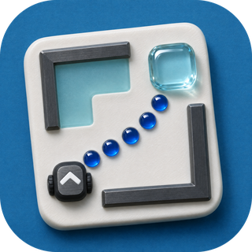
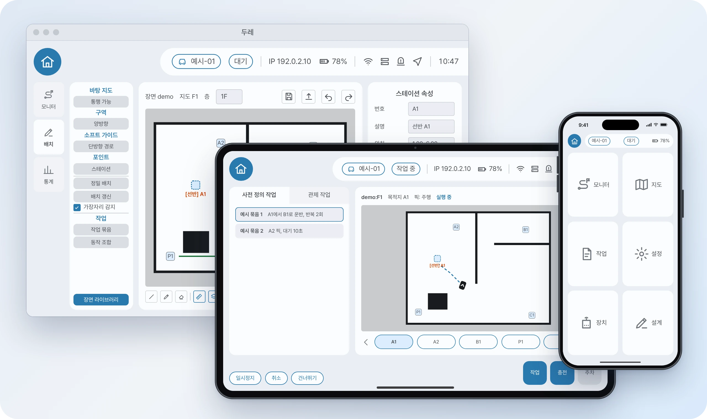
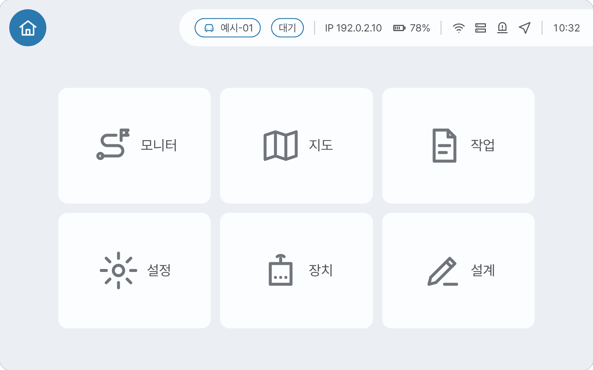
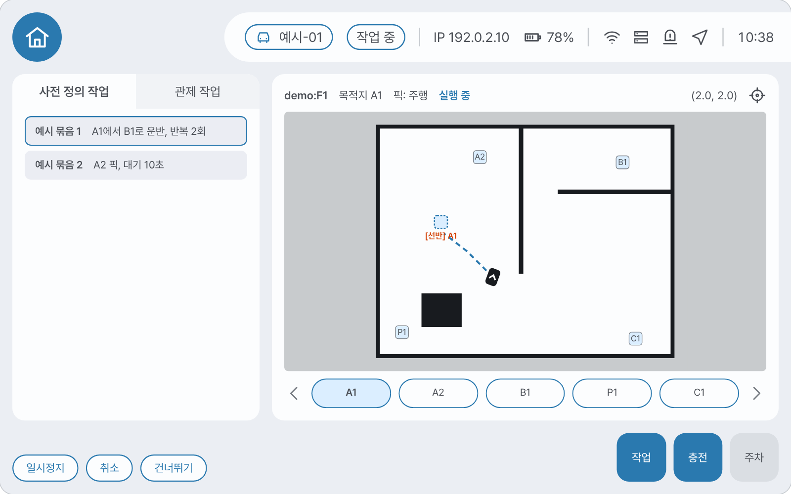
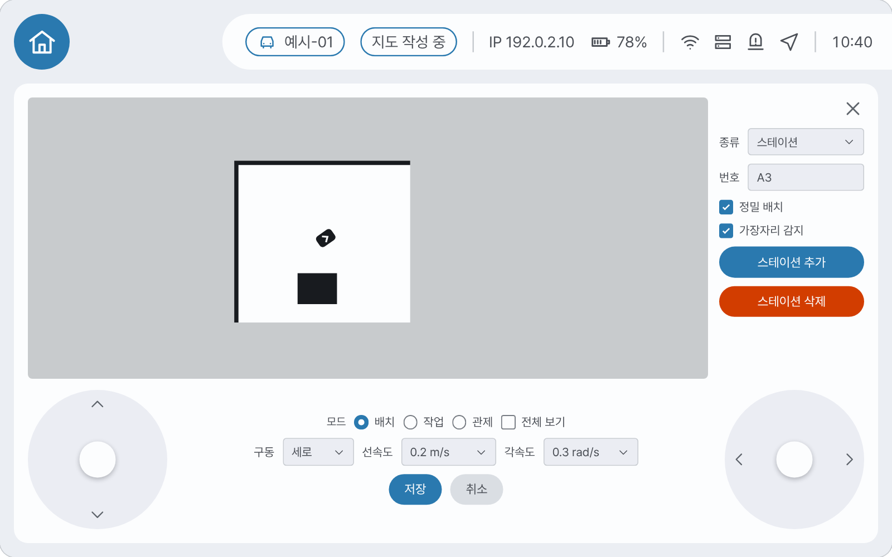
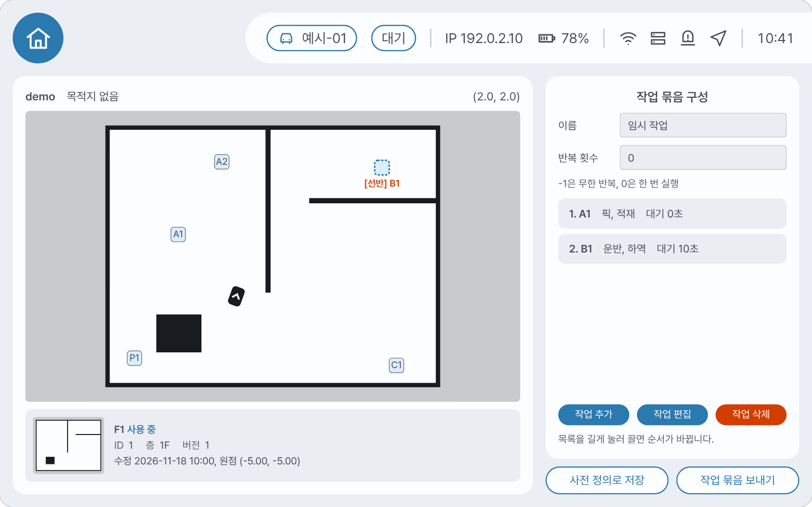
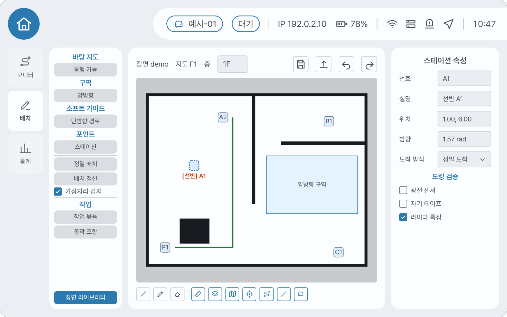
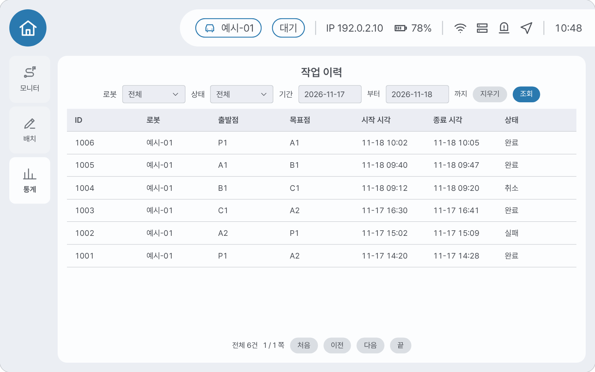
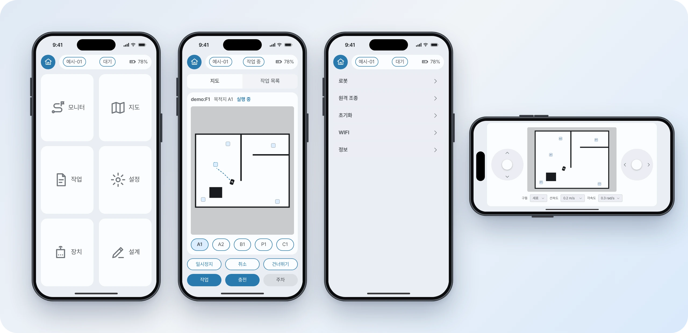
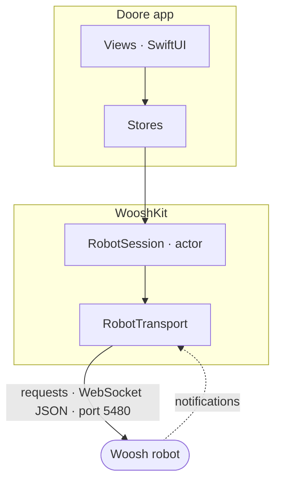

<div align="center">



<h1>두레</h1>

<p>두레 (IPA [tu.ɾe̞], English "DOO-reh", Pinyin dū lēi) is the universal app that brings Woosh Mobile and Woosh Design to iPhone, iPad and Mac.</p>

<p>
  
  
  
  <a href="LICENSE"></a>
</p>



</div>

## What is the 두레?

두레 is the Korean word for a village cooperative: neighbours who pooled their labour for work too big for one household.

## Why?

A Woosh robot is operated with Woosh Mobile and configured with Woosh Design. Woosh Mobile runs on Windows and Android, and Woosh Design runs on Windows. Someone who works on a Mac, an iPhone or an iPad has no way in.

두레 gives them one. It is a new SwiftUI app that talks to the robot over the robot's documented public API. It is not a port of the vendor's code.

People who already run robots with the original apps feel at home: every screen keeps the original's panels, and every button sits where it always was.

## Implementation status

Open `Doore.xcodeproj` in Xcode 16 or later and select the **Doore** scheme. The app targets iOS and iPadOS 17 and macOS 14. The temporary bundle identifier is `org.example.Doore`. Set the development team and production identifier before device distribution.

| Area | Implemented in the project | Still needs additional evidence |
|---|---|---|
| Connection and monitoring | Public WebSocket, ordered sync, connection history, live state, map, station selection and reconnect | Target firmware support on port 5480 |
| Operation | Task submission using action-group numbers referenced by the active scene’s presets, task control, on-screen/controller/keyboard teleoperation, position initialization, settings and supported WiFi operations | Full action-group JSON, dedicated charge/park/skip button traffic, lateral drive capability and model-specific devices |
| Site setup | Scene selection, map management, map-building requests, ordinary station registration, task sets and preset copies | Live map pixel format, precise marker deployment and creating an empty scene |
| Design | Local scene and task-set editing, undo/redo, save and backup, robot task history pages | Scene upload format, dispatch operations and the timestamps for date-range filtering |

The screenshots below show the design targets. To exercise the protocol client without a robot, run the WooshKit tests in the Build section.

## Product scope

**Operate a robot**

- Watch one robot live on its map: where it is, where it is going, what it is doing.
- Send it to a station, then pause, continue, cancel or skip the task.
- Send it to charge or to park.
- Drive it by hand with two on-screen joysticks, a game controller, or the keyboard on a Mac.
- Tell it where it is when it has lost its position.
- Change its settings, and read what a status code means and how to recover.

**Set up a site**

- Build a map by driving the robot around.
- Manage scenes and maps, and switch the robot between them.
- Register a station at the spot where the robot stands.
- Compose task sets from stations, reorder them and send them.
- Configure the robot's WiFi, and exercise its devices one at a time.

**Design a scene**

- Watch several robots at once, directly or through a dispatch server.
- Edit a scene: the base map, 13 kinds of field, soft guides and 12 kinds of point.
- Correct a station to where the robot really docks.
- Edit action groups and task sets, upload the scene, and switch the robot to it.
- Look up the task history by robot, state and period.

## Screens

<table>
  <tr>
    <td width="50%"><br><b>Home.</b> Six tiles under a status bar that stays on every screen.</td>
    <td width="50%"><br><b>Monitor.</b> The robot on its map, the station strip, and the task controls.</td>
  </tr>
  <tr>
    <td><br><b>Map building.</b> Drive with two joysticks and register stations as you go.</td>
    <td><br><b>Task.</b> Pick stations on the map to build a task set.</td>
  </tr>
  <tr>
    <td><br><b>Design · Deploy.</b> Tool palette, canvas and property panel.</td>
    <td><br><b>Design · Statistics.</b> The task history, filtered and paged.</td>
  </tr>
</table>

<div align="center">

</div>

On iPhone the same panels stack top to bottom. Teleoperation and map building turn to landscape, with a joystick under each thumb.

## One app, three devices

| | iPhone | iPad | Mac |
|---|---|---|---|
| Best at | operating on site | setting up a site | designing and monitoring |
| Layout | panels stacked | the original two-panel layout | the iPad layout in a window |
| Driving by hand | joysticks, game controller | joysticks, game controller | arrow keys or W A S D, game controller, joysticks |
| Design workspace | view only; statistics complete | complete | complete, with pointer, shortcuts, menu bar and several windows |

## Requirements

- An iPhone or iPad on iOS or iPadOS 17 or later, or a Mac on macOS 14 or later.
- A Woosh robot on the same local network, with its public API reachable on port 5480.

## Connecting to a robot

1. Join the robot's network.
2. Press the robot name in the status bar. Before a connection it reads 미연결.
3. Enter the robot's IP address. Leave the port empty to use 5480.
4. Press 연결. The first time, iOS and iPadOS ask for permission to use the local network.

The status bar then shows the robot's name, state and battery, and the map appears. The app remembers the connection and reconnects to the last robot by itself.

## Project layout

```
Doore/                 the app: views by screen area, stores, map canvas, design system
Packages/WooshKit/     the robot client: messages, transport, session, fake robot
docs/                  specification, architecture and design
```

## How it works



- **The robot owns the state.** The app shows only what the robot reported. After a request, the screen changes when the robot's notification arrives.
- **Public API first.** The documented WebSocket channel is the default. The transport is replaceable in case a robot needs the vendor's dedicated channel.
- **It moves a real machine, so it fails safe.** Letting go of the joystick, leaving the screen, backgrounding the app or losing the connection stops the robot.
- **Local network only.** No account, no cloud, no analytics. The only permission is local network access.

## Build

You need a Mac with Xcode 16 or later. Swift Package Manager fetches the one dependency, `swift-protobuf`.

```bash
git clone https://github.com/scorpion1201/doore.git
```

```bash
open doore/Doore.xcodeproj
```

Choose the `Doore` scheme, pick a Mac, an iPhone or an iPad as the destination, and run. From the command line:

```bash
xcodebuild -project Doore.xcodeproj -scheme Doore -destination 'platform=macOS' build
```

```bash
xcodebuild -project Doore.xcodeproj -scheme Doore -destination 'generic/platform=iOS Simulator' build
```

### Tests

WooshKit, the robot client, has no UI imports, so its tests run without a simulator and without a robot. They talk to a fake robot.

```bash
swift test --package-path Packages/WooshKit
```

```bash
xcodebuild -project Doore.xcodeproj -scheme Doore -destination 'platform=macOS' test
```

## Languages

Korean by default. Chinese and English can be chosen on the 정보 tab of Settings, and both use the wording of the original apps.

## Contributing

Pull requests are welcome. Read [CONTRIBUTING.md](CONTRIBUTING.md) first: it lists what a pull request must satisfy, and what is out of scope.

## License

두레 is available under the [MIT license](LICENSE).
