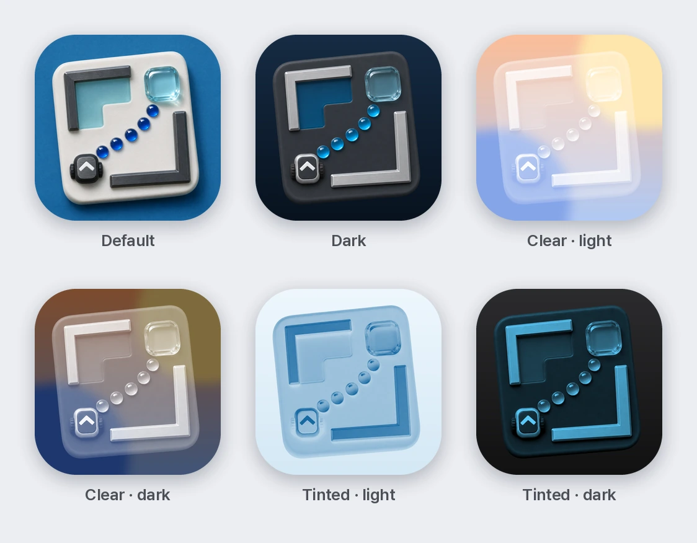

# Design

**Put the same button in the same place as the original.** 두레 moves Woosh Mobile and Woosh Design into one app for iPhone, iPad and Mac. People who already run robots with the original apps must find every control where they expect it.

For every screen, the number of panels, their positions and the order of their buttons match the original. Only four things change:

1. Korean is added and is the default language. Chinese and English stay, with the original apps' wording ([§ 12.1](#121-languages)).
2. Three button colors are adjusted so that their text meets contrast requirements ([§ 4.1](#41-colors)).
3. Icons are SF Symbols, plus newly drawn map markers.
4. The deviations listed for each screen under **Differs from the original**. If a change is not listed there, do not make it.

This document describes what the user sees. How the app must behave toward the robot is in the [specification](plans/00-initialize-app.spec.md), and how the code is organized is in [ARCHITECTURE.md](ARCHITECTURE.md).

**Reading the wording.** Every screen is shown here in Korean, the default language. The layout is identical in Chinese and English.

**Reading the sizes.** Every size is in points. iPad and Mac sizes are given for a 1280 × 800 reference screen, the size of the original Woosh Mobile window. iPhone sizes are given for a 390 × 844 reference screen. Names, addresses and numbers such as `예시-01` and `192.0.2.10` are sample values.

## 1. One app, two workspaces

The home screen keeps Woosh Mobile's five menu tiles where they were and adds **설계** in the sixth position, which was empty. Pressing 설계 opens the Woosh Design workspace: its three vertical tabs, in the original order.

Connection and preferences, which each original app had separately, are merged. Connection belongs to the robot name button in the status bar. Preferences belong to the 정보 tab of Settings.

| Original app | Original screen | Place in 두레 | iPhone | iPad and Mac |
|---|---|---|---|---|
| Mobile | Home | Home, six tiles | 2 columns | 3 columns |
| Mobile | Monitor | Home → 모니터 | yes | yes |
| Mobile | Map, map building, station editing | Home → 지도 | yes; building is landscape | yes |
| Mobile | Task | Home → 작업 | yes | yes |
| Mobile | Settings, five tabs | Home → 설정 | yes; the tabs become a list | yes |
| Mobile | Device | Home → 장치 | yes | yes |
| Design | Monitor | Home → 설계 → 모니터 tab | view only | yes |
| Design | Deploy | Home → 설계 → 배치 tab | view only | yes |
| Design | Statistics | Home → 설계 → 통계 tab | yes | yes |
| Design | Settings menu: connection and preferences | Robot name button in the status bar; 정보 tab of Settings | yes | yes |

## 2. Navigation

There is no tab bar, no sidebar and no navigation stack of the system kind. Navigation is the original's:

- **Home** shows six tiles. Pressing a tile opens that screen.
- **The status bar** is pinned to the top of every screen. Its round home button returns to Home from anywhere.

Tile order, row by row:

| | | |
|---|---|---|
| 모니터 | 지도 | 작업 |
| 설정 | 장치 | 설계 |

On iPhone the same order fills two columns: 모니터 · 지도 / 작업 · 설정 / 장치 · 설계.

| Home | iPad and Mac | iPhone |
|---|---|---|
| Grid | 3 columns × 2 rows, centred on the screen | 2 columns × 3 rows, filling the screen |
| Tile | 330 × 250, corner radius 20 | stretches to fit two columns |
| Tile content | icon 90 on the left, name at 30 pt regular on the right, 16 apart | icon 51, name at 21 pt, 8 apart |
| Gap between tiles | 20 | 16 |

## 3. Status bar and connection

The status bar is Woosh Mobile's, unchanged, on every screen including the Design workspace. Woosh Design's connection indicator at the bottom of the window is therefore removed.

### 3.1 Elements

On iPad and Mac the home button sits at the top left. The bar is a strip 80 high that hugs its content, is anchored to the right edge of the screen, and has a fully rounded left end. Its items, left to right:

| Element | Shows | When pressed |
|---|---|---|
| Home button | A house icon in a filled primary-color circle, diameter 80 | Go to Home |
| Robot name | Robot icon and 미연결 before connecting; the robot's name after | Open the connect dialog |
| State | 오프라인, 대기, 작업 중, 충전 중, 지도 작성 중, 경고, 고장 (all labels in [§ 12.3](#123-state-labels)) | Show the status code and its recovery steps |
| — separator — | | |
| IP | `IP 192.0.2.10`; `IP 없음` before connecting | nothing |
| Battery | Battery icon, percentage, charging indication | nothing |
| — separator — | | |
| Four icons | WiFi strength, dispatch server connection, emergency stop, position confirmed | nothing |
| — separator — | | |
| Clock | The current time, in tabular digits | nothing |

Robot name and state are outlined capsules ("pills"). Bar text is 22 pt.

On iPhone the bar is 46 high, the home button is 46 across, and the bar shows only the robot name, the state and the battery. Everything else is reached by pressing the robot name.

### 3.2 Appearance by state

Color is never the only signal: the text or the icon changes too.

| Situation | Robot name pill | State pill | Icons |
|---|---|---|---|
| Not connected | 미연결, grey outline, soft text | 오프라인, grey outline, soft text | all four dimmed; battery has no number |
| Normal | name, primary outline | state label, primary outline | normal |
| Warning | name | 경고, thicker `warn` outline | normal |
| Fault | name | 고장, thicker `danger` outline, `danger` text | normal |
| Emergency stop | name | current state | the emergency-stop icon turns `danger` |

### 3.3 Connect dialog

Pressing the robot name opens this dialog, centred over a dimmed screen. Its fields and their order follow Woosh Design's connect dialog, whose robot-or-dispatch choice is merged in.

| Row | Contents |
|---|---|
| Title | 로봇과 관제 연결 |
| Target | 연결 대상: radio buttons 로봇 · 관제 |
| Address | IP field; 포트 field with the placeholder `5480 (비워도 됨)`; **연결** (primary); **끊기** (quiet) |
| History | 연결 이력: one row per past connection — IP, port, target, robot name, **삭제** (danger, small) |
| Footer | **닫기** (primary, full width) |

An empty port means 5480. The app reconnects to the last robot automatically.

### 3.4 Confirmation dialogs

An action that needs confirmation asks in a dialog in the centre of the screen, as the original does. **취소** is on the left and **확인** on the right. Only the charge confirmation adds a third button, **수동 충전**, at the far left.

## 4. Tokens

Define every color and size once, in `Doore/DesignSystem/`. Views refer to tokens, never to literal values.

### 4.1 Colors

Colors come from the stylesheet embedded in Woosh Mobile. Blue and orange carry white text, which did not meet the contrast requirement, so only their lightness was lowered. The grey button was changed to a pale fill with body-color text.

| Role | Original (RGB) | 두레 | Text contrast | Used for |
|---|---|---|---|---|
| Primary button | 89, 164, 221 | `primary` with `primaryInk` text | white text 2.7:1 → 4.6:1 | run, connect, station editing, selection marks |
| Danger button | 233, 84, 19 | `danger` with `dangerInk` text | white text 3.7:1 → 4.7:1 | delete, hotspot switch, manual charge, warning text |
| Secondary button | 180, 180, 180 | `quiet` with `ink` text | white text 2.1:1 → body text 5.9:1 | cancel, disconnect, stop |
| Screen background | 235, 238, 243 | `background` | — | every screen |
| Panel | 255, 255, 255 | `surface` | — | status bar, tiles, panels, dialogs |
| Body text | 80, 80, 80 | `ink` | 7.9:1 on a panel | all text and icons |

The full token set. OKLCH is the specification; the hex value is its sRGB equivalent, to use in the asset catalog.

| Token | OKLCH | sRGB hex | Use |
|---|---|---|---|
| `background` | 94.8% 0.007 261 | `#EBEEF3` | screen background |
| `surface` | 99.4% 0.002 250 | `#FCFDFE` | panels, tiles, status bar, dialogs |
| `well` | 94.6% 0.008 271 | `#EBEDF3` | text fields, list rows, joystick base, slider track, info cards |
| `tab` | 96.4% 0.004 250 | `#F1F3F6` | unselected tabs and rail items |
| `ink` | 43.1% 0.012 255 | `#4C5057` | text and icons |
| `inkSoft` | 50% 0.014 255 | `#5E646B` | hints, placeholders, key labels, disconnected text |
| `line` | 84% 0.008 250 | `#C7CBD0` | hairlines, field borders |
| `lineStrong` | 58% 0.012 255 | `#767B81` | checkbox and radio outlines, disconnected pill outline, dimmed icons |
| `icon` | 56% 0.012 255 | `#70757C` | home tile and rail icons |
| `primary` | 55.4% 0.113 243 | `#2A79AF` | primary buttons, selection, "running" text, path on the map |
| `primaryInk` | 99.4% 0.002 250 | `#FCFDFE` | text on `primary` |
| `primaryTint` | 94% 0.03 245 | `#DBEEFE` | selected chip, banner, station marker fill, field fill |
| `danger` | 57.5% 0.196 39 | `#D23D00` | danger buttons, warning and error text, "paused" text, fault, low-battery slider |
| `dangerInk` | 99.4% 0.002 250 | `#FCFDFE` | text on `danger` |
| `quiet` | 90% 0.008 250 | `#DADEE3` | secondary buttons, switch track when off |
| `good` | 50% 0.12 150 | `#21763C` | charging, soft guides on the map |
| `warn` | 70% 0.15 75 | `#D48E00` | the warning pill's outline only; never text |
| `mapFree` | 99.4% 0.002 250 | `#FCFDFE` | free space on a map |
| `mapWall` | 22% 0.01 255 | `#181B1F` | obstacles on a map; the robot marker |
| `mapUnknown` | 84% 0.004 250 | `#C8CBCD` | unexplored area on a map |
| `scrim` | 20% 0.01 255 at 42% opacity | `#13161B` at 42% | behind dialogs |

`danger` and `warn` lie slightly outside sRGB; their hex values are the nearest sRGB colors.

The app has a light appearance only. Do not derive dark colors.

### 4.2 Sizes

| Element | iPad and Mac | iPhone |
|---|---|---|
| Status bar height | 80 | 46 |
| Home button diameter | 80 | 46 |
| Home tile | 330 × 250 | stretches to fit two columns |
| Panel corner radius | 20 | 20 |
| Button height | 44 | 44 |
| Quick action button | 79 × 79 | stretches to the available width |
| Joystick diameter | 200 | 160 |
| Tile name text | 30 | 21 |
| Status bar text | 22 | 16 |
| Button text and body text | 18 and 17 | 16 |
| Smallest text | 16 | 16 |

Further values measured from the specification's mockups. If one of them conflicts with the table above, the table above wins.

| Element | iPad and Mac | iPhone |
|---|---|---|
| Screen padding, and the gap between panels | 20 | 16 |
| Panel padding | 20 | 12 |
| Panel title text | 20, centred | — |
| Dialog | 896 wide, padding 24, title 24 pt centred | fits the screen width |
| Small button (in-row actions such as 수정, 삭제, 실행, 상세) | 34 high, 16 pt text | same |
| Text field | 39 high, 17 pt text | same |
| Station chip | up to 136 wide, 48 high | 40 high |
| List row | padding 12 × 16, 17 pt text, corner radius 10 | same |
| Vertical tab (Settings, Device) | 200 wide, about 113 high, 26 pt text | becomes a list row |
| Rail item (Design workspace) | 88 wide, icon 32 above the label | — |
| Joystick knob | 51 | 51 |
| Direction dial | 160 | — |

Touch targets are at least 44 × 44 even when the visible control is smaller.

### 4.3 Type and icons

- Use the system font, and follow the user's text size setting.
- Coordinates, speeds, times and other changing numbers use tabular digits.
- Weights: regular for body text and tile names, medium for group headings, semibold for selected items and emphasis.
- Icons are SF Symbols. Only the station markers and the robot marker on the map are newly drawn.

### 4.4 App icon

The icon is a miniature of what the app does: a floor-plan tile with wall bars and a room, a small robot seen from above, a dotted route, and the station the route leads to. It is drawn as real materials: porcelain, brushed aluminium, glass and rubber.

The picture is a simulation made for this document. On a device the system draws the clear and tinted appearances itself.

**Artwork rules.** These follow Apple's app icon guidelines for iOS, iPadOS and macOS.

- The canvas is 1024 × 1024 px and square. The system applies the rounded corners; the artwork has none.
- The default artwork is opaque and reaches all four edges.
- The subject is centred, and nothing important sits near a corner.
- No text. A small number of large shapes, with no thin lines.

**One design, three sources.** From iOS 26 an icon has six appearances. Three are designed. The system derives the other four from the mono source.

| Appearance | Source | Background | Tile | Walls | Room | Route and station | Robot |
|---|---|---|---|---|---|---|---|
| Default | default artwork | blue, `#2A79AF` | white porcelain | dark graphite aluminium | frosted pale blue glass | deep blue glass studs, clear glass pad | black rubber body, graphite top, white chevron |
| Dark | dark artwork | deep navy, `#162C44` to `#08121E` | dark graphite porcelain, about `#2B2F36` | light silver aluminium | deep blue glass, about `#1E5E8F` | sky blue glass studs, clear glass pad | silver body, graphite top, white chevron |
| Clear, light and dark | mono artwork | the wallpaper, through glass | faint | bright | faint | bright | bright chevron |
| Tinted, light and dark | mono artwork | supplied by the system | dim | bright, in the tint colour | dim | bright, in the tint colour | bright chevron |

Three rules hold across all of them:

- **The shapes never change.** Only materials and brightness do. An appearance never adds, removes or moves an element.
- **Dark is not the default with the lights off.** The tile turns dark so that nothing glares, and the walls and the robot turn light so that they still stand out against it.
- **Mono is a brightness map.** Brighter grey takes more tint, or more of the glass. So the parts that carry the meaning, the walls, the route, the station and the chevron, are the brightest, and the tile is dim. The mono artwork is the dark artwork with its colour removed.

**Files,** all in `assets/`:

| File | What it is | Used as |
|---|---|---|
| `app-icon-1024.png` | The default artwork, opaque | The single-image icon, and the `Any` appearance in an asset catalog |
| `app-icon-foreground-1024.png` | The default subject on a transparent background | The foreground layer in Icon Composer, over a `#2A79AF` background fill |
| `app-icon-dark-1024.png` | The dark subject on a transparent background | The `Dark` appearance. The system, or the background fill, supplies what is behind it |
| `app-icon-tinted-1024.png` | The mono artwork, greyscale, on a transparent background | The `Tinted` appearance, and the basis of the mono appearance |
| `app-icon-appearances.webp` | The simulated preview above | Reference only |

**Still to do, on a Mac.** The Icon Composer file (`.icon`) is not assembled yet. When it is:

- Set the background as a fill in Icon Composer, not as an image.
- Turn Liquid Glass effects off for the photographic layer. Its highlights and shadows are already in the picture, and the system's would double them.
- Check all six appearances in Icon Composer's preview against the simulation above, and adjust the mono settings until the walls, the route and the chevron read first.

## 5. Shared controls

Build each of these once and reuse it.

| Control | Appearance | Notes |
|---|---|---|
| Panel | `surface`, radius 20 | every grouped region |
| Primary button | `primary` fill, `primaryInk` text, capsule, 44 high, 18 pt | the main action of a region |
| Danger button | `danger` fill, `dangerInk` text | delete, hotspot switch, manual charge |
| Quiet button | `quiet` fill, `ink` text | cancel, disconnect, stop |
| Line button | `surface` fill, `primary` text, 2 pt `primary` border | task control; save and send on the Task screen; retry |
| Square button | any of the above with corner radius 11 instead of a capsule | button columns on Map and in the Design workspace |
| Quick action button | 79 × 79, radius 20 | 작업, 충전, 주차 on Monitor |
| Text field | `well` fill, 1 pt `line` border, radius 5; placeholder in `inkSoft` | |
| Select | a text field with a down chevron at its trailing edge | |
| Checkbox | 20 × 20; off: `lineStrong` outline; on: `primary` fill with a white check | |
| Radio button | 20 circle; off: `lineStrong` outline; on: thick `primary` ring | |
| Switch | 58 × 32; off: `quiet`; on: `primary`; white knob | |
| Slider | track 8 high in `well`, filled part `primary` | the low-battery slider fills with `danger` |
| Segmented control | 1 pt `line` border, radius 10; selected segment `primary` with `primaryInk` text | language choice |
| Tabs | `tab` strip; selected tab `surface`, semibold, 20 pt | Monitor's task list |
| Vertical tabs | `tab`; selected `surface`; rounded on the left, attached to the panel on the right | Settings, Device |
| Rail | `tab` items with icon above label; selected `surface`, semibold | Design workspace |
| Station chip | capsule with a 2 pt `primary` border; selected: `primaryTint` fill, semibold | Monitor's station strip |
| Pill | outlined capsule ([§ 3.2](#32-appearance-by-state)) | status bar |
| List row | `well` fill, radius 10; selected: 2 pt `primary` border | scene list, task lists |
| Joystick | `well` circle with a `surface` knob and a soft shadow; arrow glyphs at both ends of its axis | one axis each: vertical or horizontal |
| Direction dial | a smaller joystick-like circle whose knob sits on the rim | Init tab |
| Dialog | centred `surface` panel over the `scrim` | |
| Banner | `primaryTint` fill, radius 10 | mode mismatch |
| Skeleton | `well`-colored blocks where the map and list will be | loading |
| Tool button | 35 × 35, radius 5, 1 pt `line` border; on: `primary` border and glyph | Design toolbars and layer toggles |

## 6. Map view

One map view is shared by every screen that shows a map.

| Aspect | Rule |
|---|---|
| Colors | free space `mapFree`, obstacles `mapWall`, unexplored `mapUnknown` — always, on every platform |
| Gestures | pinch to zoom, drag to pan, double-tap to show the whole map |
| Mac | scroll to zoom, drag to pan |
| Follow | the target button in the map header keeps the map centred on the robot as its position updates |
| Station | a small rounded square in `primaryTint` with a `lineStrong` outline and its number as a label |
| Selected station | dashed `primary` outline, label in `danger` semibold; the map moves to it and shows a `[type]number` label |
| Robot | a `mapWall` rounded rectangle with a `surface` chevron pointing in the direction of travel |
| Path | dashed `primary` line |
| Field | `primaryTint` fill at 70% with a `primary` outline |
| Soft guide | solid `good` line |
| iPhone | station labels are hidden on the map to save space |

## 7. Operate screens

These are Woosh Mobile's screens. Each one keeps the original's panels, positions and button order.

### 7.1 Monitor (모니터)

See one robot's current task on the map, send a task, and stop it.

**Layout (iPad and Mac):** two columns, `400 | rest`, with a footer row across both.

| Region | Contents | Behaviour |
|---|---|---|
| Left list | Tabs **사전 정의 작업** · **관제 작업**; one row per task set, showing its name and a summary | Choose a set, then press 시작 to run it |
| Map header | `scene:map` · 목적지 · `task type: action` · progress · coordinates · follow button. Example: `demo:F1 · 목적지 A1 · 픽: 주행 · 실행 중 · (2.0, 2.0)` | Progress is `primary` while running and `danger` while paused |
| Map | Stations, the robot, the navigation path | [§ 6](#6-map-view) |
| Station strip | Station chips (`A1` `A2` `B1` `P1` `C1`) with a left and a right arrow | Paged sideways. Pressing a chip moves the map there and reveals the 작업 quick action |
| Task control (footer, left) | Idle: **시작**. Running: **일시정지** · **취소** · **건너뛰기**. Paused: **계속** takes the place of 일시정지. Line buttons | Every press asks for confirmation |
| Quick actions (footer, right) | **작업** · **충전** (primary) · **주차** (quiet), 79 × 79 each | 작업 is visible only after a station is chosen |

**Differs from the original:** nothing.

### 7.2 Map (지도)

Choose a scene and a map, and create or replace maps.

**Layout (iPad and Mac):** two columns, `400 | rest`. The right panel is itself `rest | 176` with a card strip below.

| Region | Contents | Behaviour |
|---|---|---|
| Scene list (left) | **+ 장면 추가** (primary, full width); one row per scene with its name, map count (`지도 1장`) and a **사용 중** mark; at the bottom **장면 이름 변경** (quiet) · **장면 삭제** (danger) | Choosing a scene shows its maps on the right |
| Map preview | The chosen map with its stations | The readout `X 0.00 Y 0.00` shows the position under the finger or pointer |
| Map management (right column, top to bottom) | The coordinate readout, then **지도 이름 변경** · **지도 추가** · **지도 갱신** · **지도 사용** (quiet) · **지도 삭제** (danger) · **스테이션 편집** (primary) | 지도 추가 and 지도 갱신 open the map-building screen |
| Map card (bottom) | Thumbnail 112 × 90, map name with a **사용 중** mark, ID, 층, 버전, 수정 (date and time), 원점 (x, y) | Swipe sideways to choose another map of the same scene |

**Differs from the original:** the delete confirmation repeats the name of the scene or map about to be deleted.

### 7.3 Map building and station registration (지도 작성, 스테이션 편집)

Drive the robot by hand to build a map, and register the spot where the robot stands as a station. 지도 추가, 지도 갱신 and 스테이션 편집 all open this screen.

**Layout (iPad and Mac):** one panel, `rest | 208`, with a drive row across the bottom.

| Region | Contents | Behaviour |
|---|---|---|
| Live map | The map as the robot draws it, and the robot's position | Follows the robot while building |
| Station panel (right) | Close button (✕) at the top right; **종류** select (`스테이션`); **번호** field (`A3`); checkboxes **정밀 배치** · **가장자리 감지**; **스테이션 추가** (primary) · **스테이션 삭제** (danger) | 스테이션 추가 registers the robot's current position under that number |
| Mode and drive (drive row, centre) | **모드** radios 배치 · 작업 · 관제 and a **전체 보기** checkbox; selects **구동** (`세로`), **선속도** (`0.2 m/s`), **각속도** (`0.3 rad/s`) | A map can be built only in 배치 mode |
| Joysticks (drive row, both ends) | Left: forward and backward. Right: rotation | The robot moves only while a stick is held and stops when it is released |
| Start, save, cancel (drive row, centre, below the selects) | Before building: **시작**. While building: **저장** (primary) · **취소** (quiet), in the same place | 시작 asks for the map name. 저장 and 취소 ask for confirmation |

**Differs from the original:** when the robot is not in 배치 mode, the notice has a **배치 모드로 전환** button beside it.

### 7.4 Task (작업)

Pick stations in order to build a task set, and send it to the robot.

**Layout (iPad and Mac):** two columns, `rest | 400`.

| Region | Contents | Behaviour |
|---|---|---|
| Map (left) | Header (scene, 목적지, coordinates), the map with its stations, and the map card of [§ 7.2](#72-map-지도) | Press a station to choose it as a target |
| Set details (right panel, titled **작업 묶음 구성**) | **이름** field (`임시 작업`); **반복 횟수** field with the hint `-1은 무한 반복, 0은 한 번 실행` | |
| Task list | One row per task: index, target, type and direction, wait time. Example: `1. A1 — 픽, 적재 — 대기 0초` | Long-press and drag to reorder. Hint below the buttons: `목록을 길게 눌러 끌면 순서가 바뀝니다.` |
| Task buttons | **작업 추가** · **작업 편집** (primary, small) · **작업 삭제** (danger, small) | Add and edit open a dialog that asks for type, direction, action group and wait time ([§ 9](#9-dialogs)) |
| Send (below the panel) | **사전 정의로 저장** · **작업 묶음 보내기** (line buttons) | Sending asks for confirmation |

**Differs from the original:** nothing.

### 7.5 Settings (설정)

Five vertical tabs on the left, in the original order: **로봇 · 원격 조종 · 초기화 · WIFI · 정보**. The tab column is 200 wide; the content panel takes the rest.

| Tab | Contents | Differs from the original |
|---|---|---|
| 로봇 | Control mode and work mode, dispatch server address, robot information, 7 switches, 3 battery thresholds | nothing |
| 원격 조종 | Map, two joysticks, drive mode, maximum speeds. Laid out like the lower part of the map-building screen | A stop command is sent at once when the app goes to the background or the connection drops |
| 초기화 | Set the robot's position, initialize in place, QR code reset | nothing |
| WIFI | Switch to hotspot, add a WiFi network, the saved list and its details | nothing |
| 정보 | Language, app version, connection target, request timeout, system volume, log | Korean is added as a third language and is the default. Woosh Design's connection-target display and log download move here |

**로봇 tab.** Three groups in one panel, separated by hairlines, each with its heading in a 156-wide left column.

| Group | Controls |
|---|---|
| 모드 | **제어** select (`자동`); radios 배치 · 작업 · 관제; checkbox **정차 유지**; **관제 IP** field, **관제 포트** field, **수정** (small) |
| 정보 | **이름** field with **수정** (small); read-only pairs: 번호, 서비스 번호, 모델, 크기 (`800 x 600 x 300 mm`), 적재 중량 (`200 kg`), 시스템, 위치 (`(2.00, 2.00, 0.30)`), 속도 (`0.00 m/s, 0.00 rad/s`), 배터리 1, 배터리 2 |
| 구성 | Switches: 자율 충전 · 자율 주차 · 화물 감지 · 케이블 작업 · 점유 상태 · 호출 차단 · 프로그램 음소거. Sliders with their hints, below |

| Slider | Example | Hint |
|---|---|---|
| 만충전 | 95% | 이 값보다 높아지면 자율 충전을 끝냅니다. |
| 대기 | 80% | 충전 중 이 값을 넘고 작업이 있으면 작업을 이어 갑니다. |
| 저전력 (fills with `danger`) | 20% | 이 값보다 낮아지면 자율 충전을 시작합니다. |

**원격 조종 tab.** A map that follows the robot; the left joystick for forward and backward and the right one for rotation; **구동** (세로 · 가로 · 전방향), **선속도** and **각속도** selects; a **전체 보기** checkbox, which also shows lidar points. The joysticks are disabled, with the reason shown, while the robot is charging or running a task that is not paused.

**초기화 tab.** One panel, `rest | 208`.

| Region | Contents |
|---|---|
| Instruction (top, in `danger`) | 로봇 아이콘을 길게 눌러 옮기고 다이얼로 방향을 맞춘 뒤 손을 떼면 위치가 정해집니다. |
| Map | The whole map with the robot marker. Long-press the marker and drag it |
| Right column | **로봇 아이콘을 원점으로** with the hint `로봇이 보이지 않을 때 누릅니다.`; **제자리 초기화**; **QR 코드 복위**; the direction dial, labelled `방향 다이얼` |

**WIFI tab.** **핫스팟 전환** (danger), **WiFi 추가**, the list of saved networks, and for the chosen one: name, security, password, automatic or manual IP, gateway, DNS.

**정보 tab.** Rows of a label and a control.

| Label | Control |
|---|---|
| 언어 | Segmented control: 한국어 · English · 中文. 한국어 is selected on first launch. Choosing another switches the whole UI ([§ 12.1](#121-languages)) |
| 앱 버전 | Text, for example `1.0.0` |
| 연결 대상 | Text, for example `로봇 예시-01, 192.0.2.10` |
| 통신 제한 시간 | Field (`30초`) with **수정** (small) |
| 시스템 음량 | Slider with a percentage |
| 로그 | **로그 공유** (line, small) with the hint `통신 기록을 파일로 내보냅니다.` |

### 7.6 Device (장치)

Move each device mounted on the robot directly, one at a time. The frame is the same as Settings, with a single vertical tab, **제어**. Each group puts its inputs and its run button on one line.

| Group | Inputs | Buttons |
|---|---|---|
| 음성 | **내용**: the sentence to read | 실행 · 오디오 재생 · 오디오 정지 (quiet) |
| 스텝 이동 | **종류** select (직진 · 회전 · 평행 이동 · 대각 이동); **회피 사용** checkbox; **거리** (m); **속도** (m/s) | 실행 · 취소 (quiet) |
| 팔 흔들기 | For 왼팔 and 오른팔 each: action select (`정지`), **속도** (rad/s), **각도** (rad) | 왼팔 들기 · 오른팔 들기 · 양손 흔들기 · 양손 내리기 · 실행 |
| 승강 기둥 | **속도** (m/s); **높이** (m) | 실행 · 취소 (quiet) |
| 사용자 정의 | **내용**: a multi-line command to send to the robot | 실행 |

**Differs from the original:** a group for a device the connected robot does not have is hidden.

## 8. Design workspace

Pressing 설계 on Home opens Woosh Design's workspace. A rail 88 wide on the left holds three tabs in the original order: **모니터 · 배치 · 통계**. The status bar and home button above are the same as everywhere else.

### 8.1 Monitor tab (모니터)

See several robots in a list, and check the chosen robot's position and task on the map.

**Layout:** `88 rail | 352 | rest`.

| Region | Contents | Behaviour |
|---|---|---|
| Robot list | Title **로봇 목록** with a count (`1대`); per robot: number (`No. 10001`), name, state, IP, battery, **상세** (small) | Choosing a robot moves the map to it |
| Below the list | **충전 설정** · **사전 정의 작업** (square, primary) | Each opens a dialog ([§ 9](#9-dialogs)) |
| Map header | 장면, 지도, ID, 층, **내비게이션** (small), coordinates | Press 내비게이션, then press the map: the robot drives to that point |
| Below the map | Hint `목록에서 로봇을 고르면 지도가 그 로봇으로 이동합니다.` and the layer buttons: ruler, no-go area, traffic control, field, station, path, robot | Each press shows or hides that layer |

**Differs from the original:** the connection indicator at the bottom is gone; the status bar replaces it.

### 8.2 Deploy tab (배치)

Download a scene, edit its fields, paths and stations, and upload it again.

**Layout:** `88 rail | 184 palette | rest | 272 properties`.

| Region | Contents | Behaviour |
|---|---|---|
| Tool palette | Headings in `primary` with buttons under each. **바탕 지도:** 통행 가능. **구역:** 양방향. **소프트 가이드:** 단방향 경로. **포인트:** 스테이션, then 정밀 배치, 배치 갱신 and a **가장자리 감지** checkbox. **작업:** 작업 묶음, 동작 조합. At the bottom **장면 라이브러리** (primary) | A button shows the currently chosen subtype. Long-press or right-click it to choose another ([§ 12.4](#124-editing-vocabulary)) |
| Canvas | The map with fields, paths and stations | Choose a tool, then press to add. Choose an object, then drag to move it |
| Top tools | 장면, 지도, 층 field; save, upload, undo, redo; coordinates | Nothing reaches the robot until upload |
| Bottom tools | Line, pen, eraser; then the ruler and layer buttons | Line, pen and eraser work only while editing the base map |
| Property panel | For the chosen object. A station shows **스테이션 속성**: 번호, 설명, 위치, 방향 (rad), 도착 방식 select (`정밀 도착`), and **도킹 검증** checkboxes 광전 센서 · 자기 테이프 · 라이다 특징 | A changed value shows on the canvas at once |

**Differs from the original:** objects are added by choosing a tool and pressing, instead of Alt combinations. The Mac also supports the Option combinations ([§ 11.2](#112-mac)).

Editing gestures on touch: long-press an object and then drag to move it; rotate with two fingers or with the rotation handle; edit the base map with Apple Pencil; undo and redo from the toolbar.

Before an upload, show how many items changed and ask for confirmation.

### 8.3 Statistics tab (통계)

Look up past tasks by robot, state and period.

**Layout:** `88 rail | rest`, one panel titled **작업 이력**.

| Region | Contents | Behaviour |
|---|---|---|
| Filters | **로봇** select (`전체`), **상태** select (`전체`), **기간** from and to dates, **지우기** (quiet, small), **조회** (primary, small) | The table changes only when 조회 is pressed |
| Table | Columns: ID, 로봇, 출발점, 목표점, 시작 시각, 종료 시각, 상태 | 25 rows per page |
| Pager | Total count (`전체 6건`), page (`1 / 1 쪽`), **처음** · **이전** · **다음** · **끝** | The page number can be typed to jump |

**Differs from the original:** on the Mac, pressing a column heading sorts by it.

## 9. Dialogs

The specification draws only the connect dialog. Build the others from the shared controls of [§ 5](#5-shared-controls), with the fields listed here in this order, and the button placement of [§ 3.4](#34-confirmation-dialogs).

**From Woosh Mobile**

| Dialog | Opened from | Contents |
|---|---|---|
| Task request | Monitor → 작업 | 종류, 방향, 동작 조합, target and its coordinates, custom content. Buttons 닫기 · 보내기 |
| Add or edit task | Task → 작업 추가, 작업 편집 | The task request fields plus wait time in seconds: `-1` waits indefinitely, `0` does not wait |
| Confirmation | any confirmed action | One line of question; 취소 · 확인 |
| Map name | Map building → 시작 | The scene name (fixed) and a new map name |
| Predefined task sets | Monitor | The list of task sets, call pager link (MAC address), hardware input detection, export, delete |
| Status code | The state pill | Status or abnormal code, robot state, action type, recovery steps |

**From Woosh Design**

| Dialog | Opened from | Contents |
|---|---|---|
| Robot information | Monitor tab → 상세 | Read-only tables in five groups: 정보, 구성, 모드, 상태, 장면 |
| Charge settings | Monitor tab → 충전 설정 | Threshold percentages: warning, low battery, standby, task, full charge |
| Scene library | Deploy tab → 장면 라이브러리 | Tabs for local scenes and for the robot's (or dispatch server's) scenes; open, delete |
| Task set | Deploy tab → 작업 묶음 | Name, repeat count, priority, robot type or a specific robot, task list, rules for failure and cancellation, call pager link |
| Action group | Deploy tab → 동작 조합 | The action sequence for each task type. Actions: navigate, step move, dock in, dock out, carry, wait, charge |
| Call pager | Task set dialog | Pager MAC address and button ID, with AND/OR conditions |
| Task request | Monitor tab | Robot type and number, or automatic assignment; task type, direction, action group, target |

## 10. Empty and blocked states

The original shows an empty grey map before a connection, and reports a failure only with a message that disappears. In 두레, every region that receives data has these five states.

| State | Shows | Button | Example text (map region) |
|---|---|---|---|
| Before connecting | One sentence saying what will appear here | **로봇 연결** (primary) | 로봇에 연결하면 지도와 스테이션이 여기에 표시됩니다. |
| Loading | A skeleton where the map and the list will be | none | — |
| Request failed | What failed and what to do next, in `danger` | **다시 시도** (line) | 지도 데이터를 받지 못했습니다. 로봇 연결을 확인한 뒤 다시 시도하세요. |
| Wrong mode | The required mode, in a banner | A button that switches to it, for example **작업 모드로 전환** (primary) | 작업을 보내려면 자동 모드의 작업 모드여야 합니다. |
| Connection lost | The status bar changes to 미연결 and teleoperation stops; the message is in `danger` | **다시 연결** (line) | 로봇과의 연결이 끊겼습니다. 조종을 멈추고 다시 연결하는 중입니다. |

## 11. Platform adaptation

### 11.1 iPhone

On a narrow screen, panels that sat side by side are stacked top to bottom. Button names, colors and order do not change.

| Screen | iPad and Mac | iPhone |
|---|---|---|
| Status bar | all items | home, robot name, state, battery; the rest by pressing the robot name |
| Home | 3 columns × 2 rows | 2 columns × 3 rows |
| Monitor | list and map side by side | a **지도** · **작업 목록** switch at the top; below the map the station chips, then the three task control buttons in a row, then the three quick actions in a row, each stretched to equal width |
| Map, Task | list and detail side by side | the list first; choosing an item moves to the detail |
| Settings | vertical tabs and content | the five tabs as a list with chevrons; choosing one moves to its content |
| Teleoperation, map building | one screen | locked to landscape: one joystick at each side under the thumbs, the map in the centre, the drive selects below the map |
| Design workspace | all three tabs | Monitor and Deploy are view only; Statistics is complete |

### 11.2 Mac

The Mac uses the iPad layout and adds pointer and keyboard control. Key combinations of the original Windows apps move to the Mac key in the same position.

| Item | Rule |
|---|---|
| Window size | Minimum 1280 × 800. Widening the window grows only the map region; panel widths stay fixed |
| Pointer | Hovering over a button lightens its fill one step. On a map, scroll to zoom and drag to pan |
| Teleop keys | Arrow keys, or W, A, S, D. Releasing the key stops the robot |
| Editing keys | Option-drag adds an object. Shift-drag moves one. Right-click chooses the subtype |
| Shortcuts | ⌘1 to ⌘6 open the six home tiles in order. ⌘K opens the connect dialog. ⌘Z undoes. ⌘S saves |
| Menu bar | **로봇** (연결, 끊기) · **보기** (레이어) · **작업** (일시정지, 계속, 취소) · **편집** (실행 취소, 다시 실행) |
| Windows | Monitor and Deploy can be open in separate windows |

### 11.3 iPad

The iPad uses the layouts of [§ 7](#7-operate-screens) and [§ 8](#8-design-workspace) unchanged: its landscape screen has nearly the proportions of the original 1280 × 800 window. Fixed-width panels keep their width, and the map region takes whatever is left.

## 12. Vocabulary

The original apps ship in Chinese and English. 두레 keeps both and adds Korean as the default. Code uses the English term.

### 12.1 Languages

두레 has three languages. The user chooses one with the **언어** control on the 정보 tab of Settings ([§ 7.5](#75-settings-설정)).

| Language | Wording | Where it comes from |
|---|---|---|
| 한국어 (default) | The Korean in this document, and only the words in the tables of this section | This document |
| 中文 | The original apps' Chinese text, exactly as they show it | The original apps' string table |
| English | The original apps' English text, exactly as they show it | The original apps' string table |

- **The app starts in Korean,** whatever language the device is set to. The language is an app setting, saved with the other app settings. It does not follow the system language.
- **Chinese is the original.** It is the language the original apps were written in, and their Chinese strings are used unchanged.
- **English is the original apps' own English.** Use it as written, including capitalization and word choice, even where another word would read better. A user who switches to English must see what the original app shows.
- **Do not improve, correct or retranslate** the Chinese or the English.
- **A string that exists only in 두레 has no original.** This covers the deviations listed for each screen and the messages of [§ 10](#10-empty-and-blocked-states). Write its Chinese and its English with the words the originals already use for the same things.
- **Text the robot sends** — a reply's message, a name, a station number — is shown as received, in every language.

The original string table is the `ui-text` folder of the analysis material. It lists every string of both apps in Chinese and English, by screen. It is not in this repository yet ([spec § 13.2](plans/00-initialize-app.spec.md#132-inputs-that-are-not-in-this-repository-yet)). Until it is, do not invent Chinese or English strings: ask for it.

### 12.2 Glossary

The core terms in all three languages. For the exact Chinese and English strings, including capitalization, the string table decides.

| Chinese | English | Korean |
|---|---|---|
| 监控 | Monitor | 모니터 |
| 地图 | Map | 지도 |
| 任务 / 任务集 | Task / Task set | 작업 / 작업 묶음 |
| 设置 | Setting | 설정 |
| 设备 | Device | 장치 |
| 部署 | Deploy | 배치 |
| 调度 | Dispatch | 관제 |
| 场景 | Scene | 장면 |
| 点位 / 储位 | Station / Storage | 포인트 / 스테이션 |
| 充电桩 / 泊车点 | Charger / Parkspot | 충전기 / 주차 자리 |
| 构图 | Build map | 지도 작성 |
| 遥控 | Telecontrol | 원격 조종 |
| 初始化 / 复位 | Init / Reset | 초기화 / 복위 |
| 驻车 | Hold | 정차 유지 |
| 域 | Field | 구역 |
| 软引导 | Soft guide | 소프트 가이드 |
| 虫洞 | Wormhole (a point that links floors) | 웜홀 |
| 动作组合 | Action group | 동작 조합 |
| 精度部署 | Precise deploy | 정밀 배치 |

One pair is easy to mix up. 点位 is any point placed on a map, of any of the 12 types in [§ 12.4](#124-editing-vocabulary); 储位 is one of those types. The original apps' English calls them "Station" and "Storage". In Korean, 포인트 names the palette group in Deploy, and 스테이션 names both the 储位 type and, throughout the Woosh Mobile screens, any point (스테이션 편집, 스테이션 추가). In code, the screen model for a point of any type is `Station`, and the protocol message is `woosh.map.mark.Storage`.

### 12.3 State labels

The Korean labels. The Chinese and English labels are in the original string table.

| Kind | Korean labels |
|---|---|
| Robot state | 미초기화 · 대기 · 주차 중 · 작업 중 · 경고 · 고장 · 추종 · 충전 중 · 지도 작성 중; 오프라인 when not connected |
| Control mode | 자동 · 수동 · 정비 |
| Work mode | 배치 · 작업 · 관제 |
| Task type | 픽 · 주차 · 충전 · 운반 |
| Task direction | 적재 · 하역 |
| Task state | 초기 · 준비 · 실행 중 · 일시정지 · 동작 대기 · 작업 대기 · 완료 · 취소 · 실패 |
| Action type | 주행 · 스텝 제어 · 도킹 진입 · 도킹 퇴출 · 운반 · 대기 · 충전 |
| Action order | 시작 · 일시정지 · 계속 · 취소 · 복구 · 대기 해제 · 교통 통제 · 통제 해제 |
| Drive mode | 세로 · 가로 · 전방향 |
| Step move type | 직진 · 회전 · 평행 이동 · 대각 이동 |
| Arrival mode | 대략 도착 · 정밀 도착 |

### 12.4 Editing vocabulary

The subtypes a Deploy palette button offers, in Korean.

| Palette group | Subtypes |
|---|---|
| 바탕 지도 (base map) | 통행 가능 · 미탐색 · 벽 · 주행 금지 · 교통 통제. Tools: line, pen, eraser, with a thickness in pixels |
| 구역 (field), 13 types | 양방향 · 단일 차로 · 일방통행 · 교차로 · 협로 · 위치 보정 · 경사 · 주행거리계 · 자동문 · 속도 제한 · 소방 · 경고 · 유도 |
| 소프트 가이드 (soft guide) | 단방향 경로 · 양방향 경로. Each has a width and an avoidance flag |
| 포인트 (point), 12 types | 스테이션 · 선반 · 주차 자리 · 충전기 · 팔레트 대 · 리프트 카트 · 견인 트레일러 · 롤러 스테이션 · 로봇 팔 작업대 · 웜홀 · 유도점 · QR 코드 |

Property groups the panel can show, depending on the chosen object:

| Group | Fields |
|---|---|
| Basic information | ID, number, description, type |
| Position | real pose and docking pose (x, y, heading), fine adjustment |
| Arrival mode | 대략 도착, 정밀 도착 |
| Docking identification | QR code number, RFID; 0 means not recognized |
| Docking verification | photoelectric sensor (load present), magnetic tape, lidar feature, QR code |
| Feature plate type | VL, parallel, convex, four-point rectangle, magnetic tape guide, RFID guide |
| Parking and charging | the robot ID that uses it; whether a charger also serves as a parking spot |
| Elevator and wormhole | wide or narrow door, IP, port, same-elevator mark, reachable map IDs, connection token |
| Field rules | driving mode (avoid, wait, fail or replan on timeout), wait time, speed limit, number of robots allowed at once |
| Narrow passage, automatic door, slope | entry and exit points, radius, offset, slope angle and direction |
| Guide | guide point ID and type (wait, U-turn, wormhole, segment, mutual exclusion) |
| Custom | free-form data |

## 13. Accessibility

- Text follows the system text size setting. Nothing is smaller than 16 pt at the default size.
- Text contrast is at least 4.5:1: the values are in [§ 4.1](#41-colors). `warn` is used for an outline only, because it does not meet this as text.
- State is never shown by color alone ([§ 3.2](#32-appearance-by-state)).
- Touch targets are at least 44 × 44.
- Every icon-only control has an accessibility label in the current language: the home button, the follow button, layer toggles, toolbar tools, the four status icons.
- On iPhone, give haptic feedback when teleoperation starts and stops, and when sending a task succeeds or fails.

## 14. Open design questions

The specification leaves these open. Use the default, and ask the owner if the default does not fit.

| Question | Default until answered |
|---|---|
| The Design Monitor tab on iPhone is "view only" in the structure table but "unchanged" in the iPhone table | View only: no navigation command from the phone |
| The iPhone landscape mockup for teleoperation shows no status bar and no way out | Keep the home button visible in the top-left corner |
| iPad in portrait, Split View and Stage Manager are narrower than the reference layout | Use the iPhone layout when the horizontal size class is compact, and the iPad layout otherwise |
| No mockup exists for the WIFI tab, the 원격 조종 tab, any dialog except connect, or the iPhone versions of Map, Task, Device and the Design workspace | Build from the tables here and the shared controls |
| Woosh Design has a separate soft-guide layer toggle; the specification draws seven layer buttons without it | Seven buttons as drawn; soft guides follow the path toggle |
| Woosh Design's Monitor has a task-list drawer at the right edge, listing task sets that wait for assignment and those that are running; the specification does not draw it | Leave it out until the owner decides |
| Only "all dimmed" and "emergency stop" are drawn for the four status icons | Active in `ink`, inactive in `lineStrong` |
| 미초기화, 주차 중 and 추종 have no status bar example | The normal pill style |
| A dark appearance | Not supported |
| The original apps apply a language change only after a restart | Apply it at once, without a restart |
| The order of the three languages in the 언어 control | 한국어 · English · 中文, as the specification draws it |

## 15. Provenance

This document condenses "Woosh 유니버설 UI 설계서" (version 2.0.0), which pairs a mockup of each 두레 screen with a screenshot of the original. Color values and the measurements of [§ 4.2](#42-sizes) marked as measured were read from those mockups. The hex values were computed from the specified OKLCH values.

Three kinds of content come from the earlier analysis document, because the UI specification does not cover them: the dialog field lists of [§ 9](#9-dialogs), the state labels and editing vocabulary of [§ 12](#12-vocabulary), and the touch editing gestures of [§ 8.2](#82-deploy-tab-배치). Where the two documents disagreed about navigation, layout or color, the UI specification was followed.

The language rules of [§ 12.1](#121-languages) are the owner's decision, made after both documents: Korean by default, with Chinese and English switched from Settings and taken unchanged from the original apps. They replace the specification's statement that the app uses Korean wording only.
